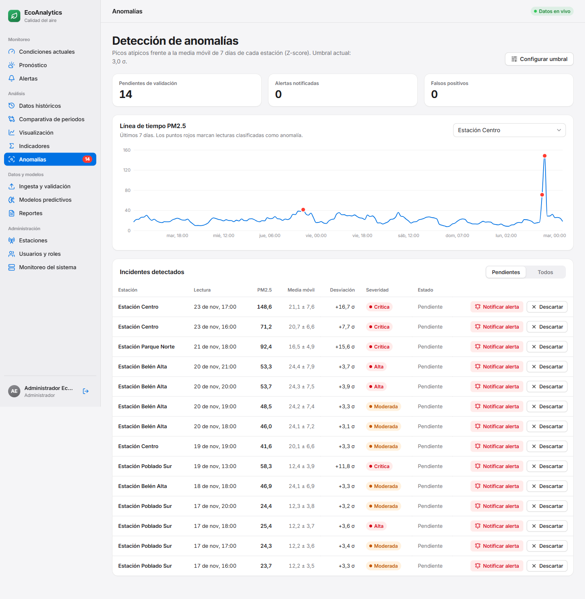

# Verificación del despliegue AWS de EcoAnalytics

Fecha: 24 de noviembre de 2026, America/Bogota. Aplicación: https://dsjd5zau1tr4h.cloudfront.net.

| Comprobación | Resultado |
|---|---|
| Pruebas Java del dominio | 6 ejecutadas, 0 fallos y 0 errores. |
| Frontend TypeScript/Vite | Compilación de producción terminada correctamente. |
| Página y API públicas | HTTPS válido; `/` y `/api/condiciones` respondieron HTTP 200. |
| Postman: colección principal | 39 peticiones y 93 comprobaciones aprobadas, 0 fallidas. |
| Postman: importación CSV | 5 peticiones y 14 comprobaciones aprobadas, 0 fallidas. |
| Importación | Tres registros confirmados; segunda confirmación rechazada con 409. |
| Copia MongoDB en S3 | Archivo, SHA-256 y manifiesto presentes en el bucket privado. |
| Restauración aislada | 51.474 documentos restaurados sin fallos; coincidencia de conteos en 13 colecciones, con 51.365 mediciones en esa copia. |
| Sesión web | Login administrador, monitoreo y navegación por estaciones/anomalías mediante el dominio público; sin errores de consola observados. |

Las dos colecciones reúnen **44 peticiones y 107 comprobaciones**, sin contar una repetición como cobertura adicional. La copia se realizó antes de la prueba de ingesta; por tanto, el número de mediciones de la base activa puede ser mayor.

Se comprobó que los contenedores permanecen activos y que Systems Manager permite consultar la instancia. El consumo observado durante una consulta puntual fue aproximadamente 314 MiB para Java, 246 MiB para MongoDB y 4 MiB para Nginx; estas lecturas no constituyen un estudio de carga ni un máximo garantizado.

Los reportes Postman completos, con sus datos de sesión, permanecen en archivos privados excluidos de Git. Las capturas de las pantallas y el resumen no incluyen JWT ni contraseñas de infraestructura.

No se verificaron carga concurrente sostenida, todos los criterios de aceptación, alta disponibilidad, recuperación de zona/región o entrega real de correo/push. La base de demostración contiene datos sintéticos.
