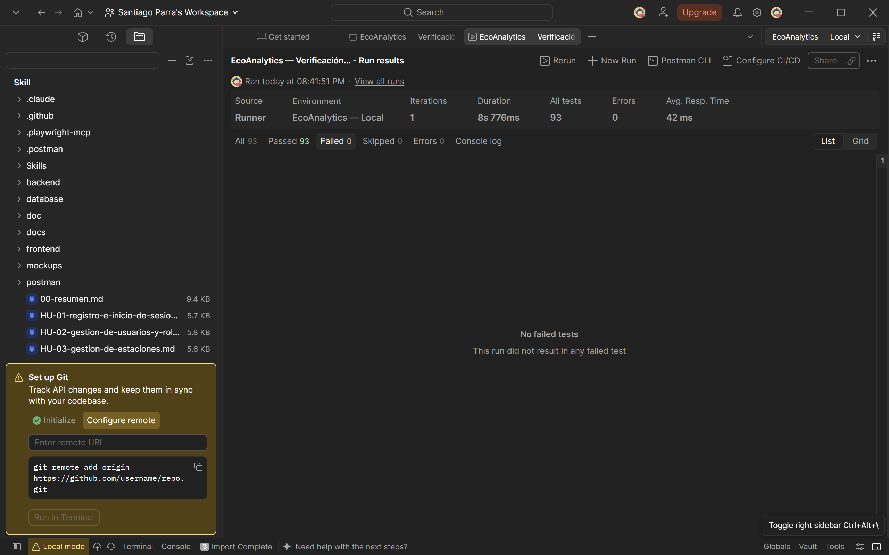

# Evidencia de pruebas de EcoAnalytics con Postman

Ejecución local: 23 de noviembre de 2026 (America/Bogota). Backend Java en `http://localhost:8080` y MongoDB local; datos demo existentes. No se realizó despliegue en AWS.

| Ejecución | Peticiones | Comprobaciones aprobadas | Comprobaciones fallidas |
|---|---:|---:|---:|
| Colección principal, Postman CLI | 39 | 93 | 0 |
| Importación CSV, Postman CLI | 5 | 14 | 0 |
| Colección principal, Runner de Postman Desktop | 39 | 93 | 0 |

Las dos colecciones tienen 44 peticiones y 107 comprobaciones en conjunto. La ejecución adicional en Desktop repitió las 39 peticiones principales; no añade casos distintos a esa cifra.

## Resultado comprobado

- Inicio de sesión de administrador, analista y ciudadano, con captura automática de JWT.
- Consultas de los módulos asociados a HU-01 a HU-16, según el alcance descrito en la guía.
- Exportación del histórico, comparación e incidencias en CSV; reportes en PDF, CSV y Excel.
- Rechazos esperados por falta de autenticación, permisos, campos inválidos, fechas invertidas, estación inexistente, horizonte no permitido y períodos sin datos.
- Lote de ejemplo número 1: tres registros válidos, tres importados, estado `IMPORTADO`.
- Repetir la confirmación del mismo lote devolvió `409 Conflict`, como se esperaba.

En una primera ejecución, la exportación de comparación devolvió `422` porque el intervalo elegido tenía cobertura insuficiente. Se ajustó el dato de prueba `fecha_referencia` al histórico disponible (`2026-10-31`) y se añadió un caso negativo independiente que espera `422` cuando no hay datos. No se modificó la regla del backend para aprobar la prueba.

## Evidencia visual

La captura se revisó visualmente. Las dos colecciones y el entorno quedaron importados en Postman Desktop, modo local, con el entorno **EcoAnalytics — Local** seleccionado.

## Alcance pendiente

Estas verificaciones no equivalen a certificar todos los criterios de aceptación. No se ejecutaron flujos completos de creación/edición de usuarios y estaciones, entrenamiento y despliegue de modelos, ni modificaciones de configuración. Tampoco se verificaron entrega real de notificaciones, precisión predictiva, carga concurrente o disponibilidad en AWS.

Los reportes JSON completos permanecen en esta carpeta local excluidos de Git, porque incluyen datos de sesión. Este resumen y la captura no contienen contraseñas ni JWT.
